<!-- banner -->

<picture><source media="(prefers-color-scheme: dark)" srcset="assets/banner/banner-dark.svg">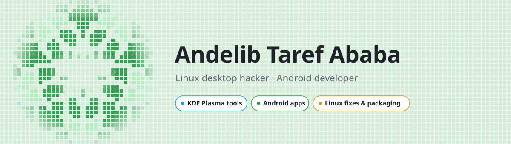</picture>

<!-- intro -->

Hi, I'm Andelib. I build tools that make the Linux desktop nicer to live in, mostly for <b>KDE Plasma</b>, and <b>privacy-first Android apps</b> that work offline. I like chasing down the bugs that annoy everyone, then shipping the fix.

## 🛠️ What I build

<table>
  <tr>
    <td width="33%" valign="top">
      <b>KDE Plasma tools</b> 
      KWin scripts and Dolphin add-ons that make Plasma 6 tile, snap, preview and remember. 
      <a href="https://github.com/IamAndelib/Tessera">Tessera</a> · <a href="https://github.com/IamAndelib/KPeek">KPeek</a> · <a href="https://github.com/IamAndelib/kde-snap-overlay">snap-overlay</a> · <a href="https://github.com/IamAndelib/window-geometry-restore">geometry-restore</a>
    </td>
    <td width="33%" valign="top">
      <b>Android apps</b> 
      Offline-first apps with no ads, no analytics and no sign-up. 
      <a href="https://github.com/IamAndelib/Tally-android">Tally</a> · <a href="https://github.com/IamAndelib/CyberJuke">CyberJuke</a>
    </td>
    <td width="33%" valign="top">
      <b>Linux fixes &amp; packaging</b> 
      Evidence-based fixes for suspend, Bluetooth and Flatpak quirks, plus Flatpak packaging. 
      <a href="https://github.com/IamAndelib/linux-suspend-instant-wake-fix">suspend fix</a> · <a href="https://github.com/IamAndelib/linux-bluetooth-wake-reconnect">bluetooth fix</a> · <a href="https://github.com/IamAndelib/plasma-browser-integration-flatpak-fix">browser-integration fix</a>
    </td>
  </tr>
</table>

## 🌟 Featured projects

<a href="https://github.com/IamAndelib/Tally-android"><picture><source media="(prefers-color-scheme: dark)" srcset="assets/cards/tally-dark.svg">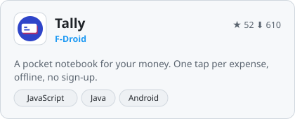</picture></a>
<a href="https://github.com/IamAndelib/Tessera"><picture><source media="(prefers-color-scheme: dark)" srcset="assets/cards/tessera-dark.svg">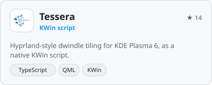</picture></a>

<a href="https://github.com/IamAndelib/KPeek"><picture><source media="(prefers-color-scheme: dark)" srcset="assets/cards/kpeek-dark.svg">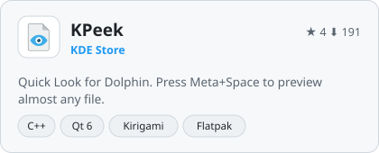</picture></a>
<a href="https://github.com/IamAndelib/CyberJuke"><picture><source media="(prefers-color-scheme: dark)" srcset="assets/cards/cyberjuke-dark.svg">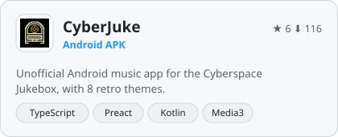</picture></a>

<a href="https://github.com/IamAndelib/kde-snap-overlay"><picture><source media="(prefers-color-scheme: dark)" srcset="assets/cards/kde-snap-overlay-dark.svg">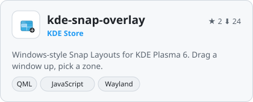</picture></a>
<a href="https://github.com/IamAndelib/window-geometry-restore"><picture><source media="(prefers-color-scheme: dark)" srcset="assets/cards/window-geometry-restore-dark.svg">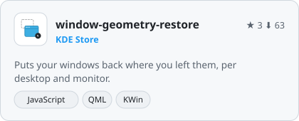</picture></a>

<a href="https://github.com/IamAndelib/Redux-Video-Player"><picture><source media="(prefers-color-scheme: dark)" srcset="assets/cards/redux-video-player-dark.svg">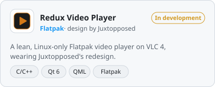</picture></a>

## 🧰 Toolbox

<picture><source media="(prefers-color-scheme: dark)" srcset="assets/skills/skills-dark.svg">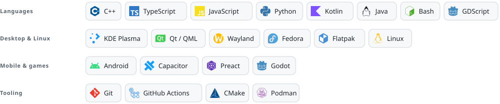</picture>

## 📈 Activity

<picture><source media="(prefers-color-scheme: dark)" srcset="profile/stats-dark.svg"></picture>
<picture><source media="(prefers-color-scheme: dark)" srcset="profile/top-langs-dark.svg"></picture>

<picture><source media="(prefers-color-scheme: dark)" srcset="profile/snake-dark.svg"></picture>

## 📫 Find me

<a href="https://iamandelib.github.io"><picture><source media="(prefers-color-scheme: dark)" srcset="assets/links/website-dark.svg"></picture></a> <a href="https://github.com/IamAndelib"><picture><source media="(prefers-color-scheme: dark)" srcset="assets/links/github-dark.svg"></picture></a> <a href="https://gitlab.com/IamAndelib"><picture><source media="(prefers-color-scheme: dark)" srcset="assets/links/gitlab-dark.svg"></picture></a> <a href="https://www.linkedin.com/in/andelibababa/"><picture><source media="(prefers-color-scheme: dark)" srcset="assets/links/linkedin-dark.svg"></picture></a> <a href="mailto:andelibtarefsrizon@gmail.com"><picture><source media="(prefers-color-scheme: dark)" srcset="assets/links/email-dark.svg"></picture></a> <a href="https://ko-fi.com/iamandelib"><picture><source media="(prefers-color-scheme: dark)" srcset="assets/links/kofi-dark.svg"></picture></a>

andelibtarefsrizon@gmail.com

More Linux bits: <a href="https://github.com/IamAndelib/Frosted-Color-Plasma-Style">Frosted Breeze Plasma style</a> · <a href="https://github.com/IamAndelib/alucard-dracula-light-kde">Alucard color scheme</a> · <a href="https://github.com/IamAndelib/openbangla-keyboard-flatpak">OpenBangla Flatpak</a>

